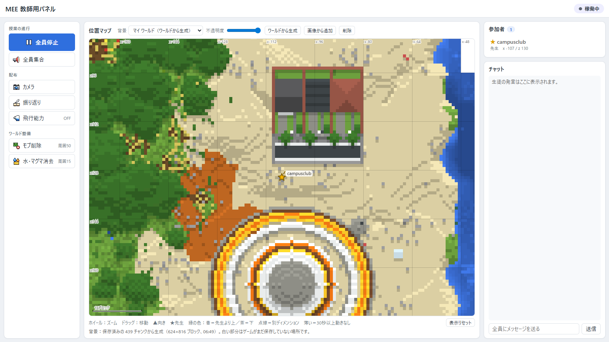
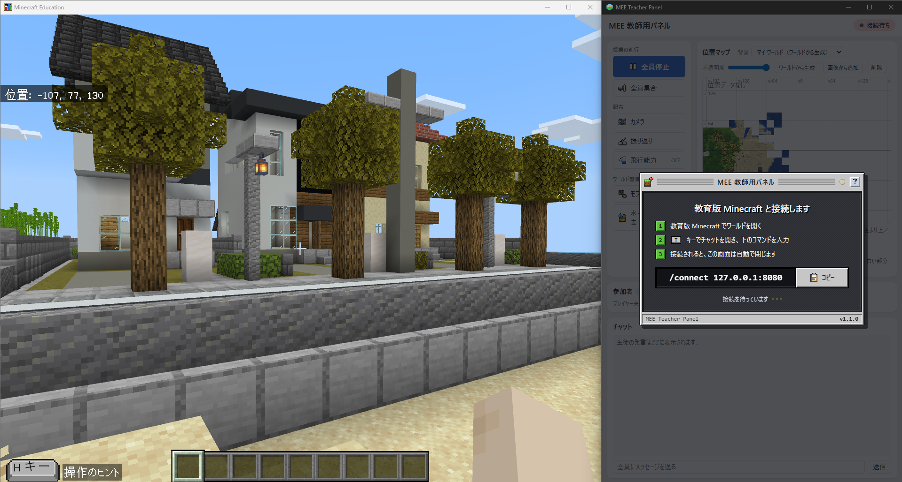
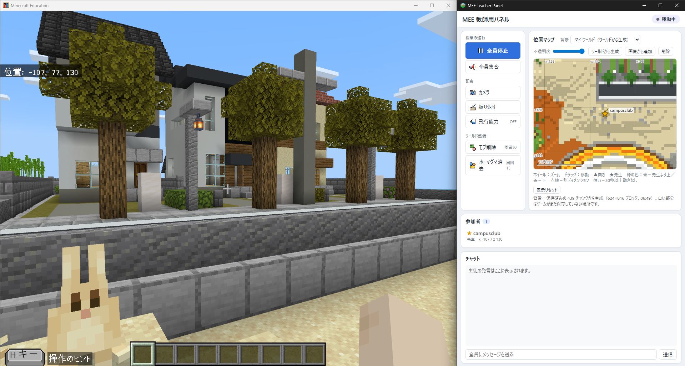

# MEE Teacher Panel

Minecraft Education（教育版マインクラフト）用の教員向けコントロールパネル。Electron アプリとして動き、MEE の WebSocket 接続（`/connect`）を受けてコマンド送信・イベント受信を行う。



## 機能

- **一時停止/再開（PAUSE ON/OFF）**：停止時はまず全員の `canMove` タグを外し、先生（接続元 `@s`）にだけ付け直して除外する。タグのない全員を `inputpermission`（movement / camera を disabled）で凍結して adventure にする。`inputpermission` が失敗した接続では slowness / mining_fatigue（255、パーティクル非表示）に自動で切り替える（方式は接続ごとに判定し直す）。タイトル「ストップ／話を聞く時間だよ」を表示。停止中は 5 秒ごとに凍結と actionbar 表示を再適用し、入室・リスポーンした生徒はすぐ止める（許可済みの生徒は除く）。停止中に再接続した場合も維持を再開する。解除時は全員の inputpermission を enabled に戻し、effect clear・title clear・creative。
- **許可**：停止中に指定プレイヤーへ `canMove` タグを付け、凍結・効果・タイトルを解除して creative に戻す。先生は最初から停止対象外なので操作は不要。
- **全員集合／個別集合**：`tp @a @s` / `tp "<名前>" @s`。
- **アイテム配布**：カメラ＋ポートフォリオ、振り返り用の本と羽ペン（writable_book）。
- **飛行能力**：`ability @s mayfly true|false`。ON/OFF はサーバー側で持つので、画面を開き直しても表示が合う（MEE の切断ではリセットしない）。
- **モブ削除**：先生の周囲 50 ブロックの、プレイヤー・落ちているアイテム以外のエンティティを `kill`。授業で置く NPC・エージェント・三脚カメラと、防具立て・絵画・トロッコ・ボート・リードの結び目は残す（除外リストは `main.js` の `KILL_EXCLUDE_TYPES`）。
- **水・マグマ消去**：`fill ~-15 ~-15 ~-15 ~15 ~15 ~15 air replace <ブロック>` を water / flowing_water / lava / flowing_lava の 4 回（先生の周囲 15 ブロック、31×31×31）。
- **チャット**：`say` での送信（改行は空白にする）と、PlayerMessage の表示。パネル自身が送ったタイトル文言は一定時間チャットログから除外する。
- 操作ボタンは MEE 未接続のとき 503 を返し、画面に「送信エラー」が出る（停止解除だけは未接続でもパネル側の停止状態を解除する）。
- **参加者名簿**：`list` を 3 秒ごとにポーリングして名簿を作る。先生（ホスト）は接続時に `getlocalplayername` で名前を取得して判別する。
- **位置マップ**（canvas）
  - 位置は PlayerTransform などのイベントと `querytarget` の 1 秒ポーリングで取得し、100ms ごとに差分を SSE で配信、ブラウザ側で補間して描く。高 DPI 対応。
  - マーカー：▲向き、★先生、縁の色で高さ（青＝先生より上／茶＝下）、点線＝別ディメンション、半透明＝30 秒以上動きなし。ホバーで名前・座標・最終更新を表示。
  - **背景**はプリセットとして保存・切替・削除でき、不透明度を変えられる。
    - **ワールドから生成**：PC 上のワールドの LevelDB を直接読み、真上から見た地図（1 ブロック = 1px）を PNG で作る。位置合わせは自動。範囲は「自動（保存済みの地形すべて、1 辺最大 2048）」または 256 / 512 / 1024 / 2048、中心は先生の現在地かスポーン地点。同じワールドから再生成すると同じプリセットを置き換える。
    - **画像から追加**：任意の俯瞰画像を読み込み、画像上の 2 点にゲーム内座標を対応付ける（2 点キャリブレーション。回転・拡大も補正）。

### 背景地図の注意点

- 描けるのは**ディスクに保存済みのチャンクだけ**。プレイ中は `.log` に少しずつ書かれるだけなので、未保存の場所は白く抜ける。ワールドを終了するか自動保存の後に再生成すると広がる。
- 地上世界（y=-64..319、サブチャンク形式 v1/8/9）のみ対応。
- 生成はワーカースレッドで実行する（大きいワールドで数秒〜数十秒。例：7767 チャンク・2000×1744 で約 8 秒）。
- 画像ファイル名は生成ごとに `<presetId>-<時刻>.png` に変わる（ブラウザキャッシュ対策）。

## セットアップ

### 前提条件

- Node.js
- Minecraft Education（Windows 版。ワールドは `%LOCALAPPDATA%\Packages\Microsoft.MinecraftEducationEdition_8wekyb3d8bbwe\LocalState\games\com.mojang\minecraftWorlds` から読む）

### インストールと実行

```bash
npm install
npm start
```

起動すると接続画面に `/connect 127.0.0.1:8080` が表示されるので、MEE（先生のクライアント）のチャットで実行する。



接続すると接続画面が閉じ、右上の表示が「稼働中」になる。MEE とパネルを並べて使う。



> **ネットワークドライブ上では `npm start` が起動しない**（`GPU process launch failed: error_code=18`）。Windows の制限で、Electron の子プロセスをネットワーク上の exe から起動できないため。ローカルディスクに置いて実行するか、Electron 本体をローカルにコピーして起動するスクリプトを使う。

## スクリプト

- `npm start`：Electron アプリを起動する。
- `npm run dist`：electron-builder でビルドする。
- `npm run dist:win`：Windows 用にビルドする（NSIS インストーラーとポータブル版、x64。`dist/` に出力）。

ビルドに含めるファイルは `package.json` の `build.files` で指定している。新しいモジュールを足したらここにも追加すること。

## 仕組み

```
MEE ──WebSocket :8080──▶ main.js ──SSE /events──▶ public/index.html（Electron の画面）
                          ▲  └── HTTP API :3000 ◀──┘
                          └── worldmap.js（Worker）── LevelDB（minecraftWorlds）
```

- **待ち受け**：HTTP :3000 と WS :8080 はどちらも `127.0.0.1` だけで待ち受ける。校内 LAN の他の PC から画面を操作されたり、生徒の MEE から `/connect` されて接続を奪われたりしないため。MEE とパネルは同じ PC で動かす前提。
- **MEE との通信（WS :8080）**：接続直後に `enableencryption` で鍵交換（ECDH secp384r1）し、以後は AES-256-CFB8 で暗号化して送受信する。鍵交換中のコマンドはキューに積む。コマンドの応答は requestId で照合する。
- **購読イベント**：PlayerJoined / PlayerSpawned / PlayerLeft / PlayerRemoved / PlayerMessage / PlayerTransform / PlayerTravelled / PlayerMoved（Tick は購読しない。停止の維持はタイマーで行う）
- **画面への配信（SSE `/events`）**：`hello` / `state`（名簿・停止状態など）/ `pos`（位置の差分）/ `chat`
- **HTTP API（:3000）**
  - 操作：`/api/pause_on` `/api/pause_off` `/api/allow_name` `/api/gather` `/api/gather_name` `/api/camera_items` `/api/review_items` `/api/mayfly` `/api/kill_mob_r50` `/api/clear_fluids_r16_self` `/api/chat_send`（すべて POST）
  - 背景プリセット：`GET/POST /api/map_presets`、`GET /api/map_presets/:id/image`、`DELETE /api/map_presets/:id`、`POST /api/map_presets/select`
  - ワールド地図：`GET /api/worlds`（ワールド一覧と先生の位置）、`POST /api/worldmap`（`{ worldId, size: 'auto' | 256 | 512 | 1024 | 2048, center: 'teacher' | 'spawn' }`）
- **背景プリセットの保存先**：Electron の userData 配下 `map-presets/`（`presets.json` と画像ファイル）

## プロジェクト構成

- `main.js`：Electron のエントリーポイント。MEE 用 WebSocket サーバー（暗号化を含む）、UI 用の Express サーバー（HTTP API・SSE）、名簿と位置の管理、背景プリセットの保存を担う。
- `worldmap.js`：ワールドの読み取りと地図の描画。LevelDB（SSTable・ログ）、NBT、Bedrock のサブチャンクを読み、ブロック名から色を決めて高さで陰影を付け、PNG に出力する。外部ライブラリなし。ワーカースレッドとしても動く（`job: 'render' | 'auto'`）。
- `public/index.html`：画面（HTML・CSS・JS を 1 ファイルにまとめている）。
- `public/icons/`：画面で使うドット絵アイコン（16×16 の SVG）。
- `build/icons/`：アプリのアイコン（electron-builder が使う）。
- `package.json`：依存関係、スクリプト、electron-builder の設定。

`main.js` と `public/index.html` の後半には旧版のコードがコメントアウトで残っている。
