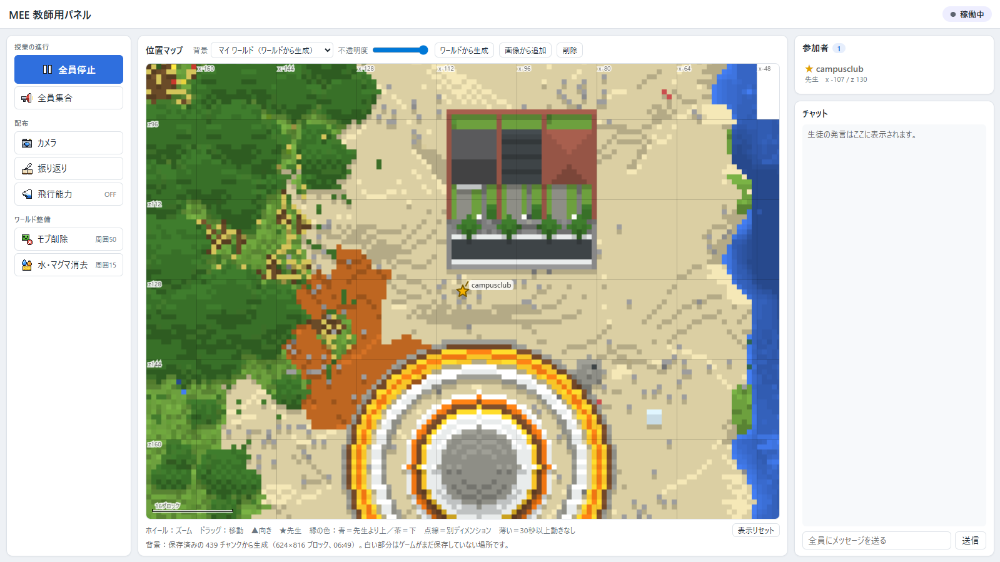
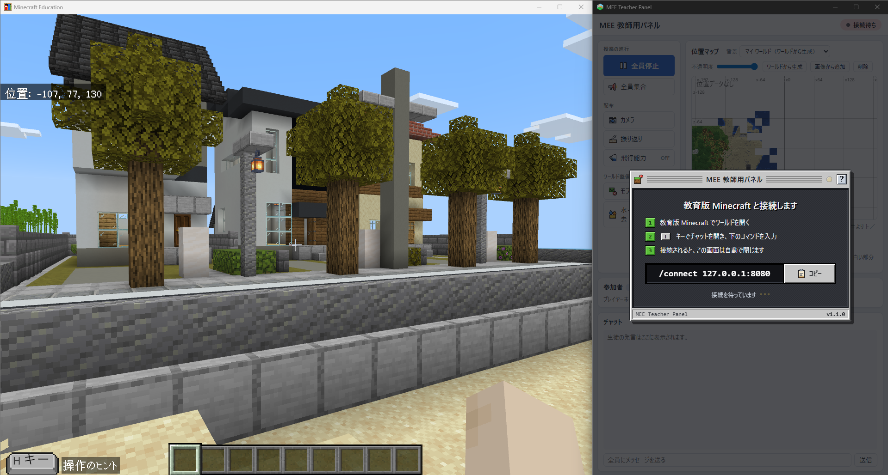
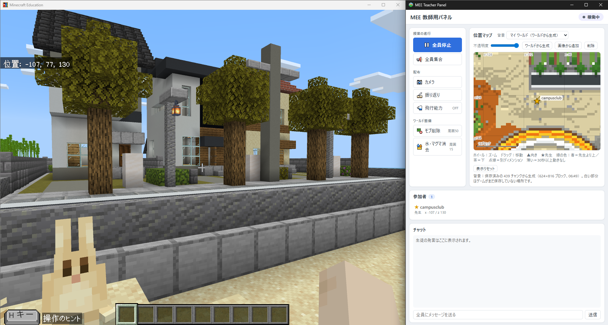

# MEE Teacher Panel

Minecraft Education（教育版マインクラフト）用の教員向けコントロールパネル。Electron アプリとして動き、MEE の WebSocket 接続（`/connect`）を受けてコマンド送信・イベント受信を行う。



## 機能

- **一時停止/再開（PAUSE ON/OFF）**：停止時はまず全員の `canMove` タグを外し、先生（接続元 `@s`）にだけ付け直して除外する。タグのない全員を `inputpermission`（movement / camera を disabled）で凍結して adventure にする。`inputpermission` が失敗した接続では slowness / mining_fatigue（255、パーティクル非表示）に自動で切り替える（方式は接続ごとに判定し直す）。タイトル「ストップ／話を聞く時間だよ」を表示。停止中は 5 秒ごとに凍結と actionbar 表示を再適用し、入室・リスポーンした生徒はすぐ止める（許可済みの生徒は除く）。停止中に再接続した場合も維持を再開する。解除時は全員の inputpermission を enabled に戻し、effect clear・title clear。ゲームモードは、停止していた生徒だけを「解除後」の設定（クリエイティブ／サバイバル／アドベンチャー）に戻す。「変更しない」にすると、停止・解除のどちらでもゲームモードを変えない。
  - 停止中にパネルを閉じようとすると確認が出る（「解除して終了」を選ぶと解除してから終了する）。
- **許可**：停止中に指定プレイヤーへ `canMove` タグを付け、凍結・効果・タイトルを解除して「解除後」のゲームモードに戻す。先生は最初から停止対象外なので操作は不要。
- **全員集合／個別集合**：`tp @a @s` / `tp "<名前>" @s`。
- **生徒の所へ移動・地点へ移動**：名簿の「見に行く」または地図上の生徒をクリックして `tp @s "<名前>"`。地図を右クリックすると、その地点へ先生または全員を移動できる（高さが分からないので `spreadplayers <x> <z> 0 1 <対象>` で地表に置く。読み込まれていない遠い場所は失敗し、理由を画面に表示する）。
- **タイマー**：残り時間を全員のアクションバーに毎秒表示する（3 分より多い＝白、3 分以下＝水色、1 分以下＝ピンク）。開始時に「あと◯分で終わりだよ」、終了時に「終わりだよ」（90 秒間）をタイトル表示。オプションで「終了時に全員停止」「夕暮れの演出」（開始時に `time set 12000` と `gamerule dodaylightcycle false`、残り 3 分で `true` に戻す）。文言は「文言を編集」で変更できる。
- **お知らせ**：定型文ボタン、またはチャット欄の「大きく」で、全員の画面中央にタイトル表示する（12 文字以下はタイトル、それより長い文は「お知らせ」＋サブタイトル）。同じ文を `say` でチャットにも流す。
- **授業準備**：昼に固定／晴れに固定／攻撃し合えない（pvp）／TNT 無効／モブが湧かない／持ち物を保持を、ボタンで ON/OFF する（`gamerule` と `time set day`・`weather clear`）。現在の状態は接続時に `gamerule` の一覧から読む。
- **離れすぎの警告**：先生から設定した距離（50／100／200 ブロック）以上離れた生徒と、別ディメンションにいる生徒を、名簿と地図（赤い縁・範囲の円）で強調する。
- **記録の保存**：チャット（起動中の全件、最大 5000 件）と位置（全員を 5 秒ごと）を CSV で保存できる（Excel で開ける BOM 付き UTF-8）。
- **アイテム配布**：カメラ＋ポートフォリオ、振り返り用の本と羽ペン（writable_book）。
- **飛行能力**：`ability @s mayfly true|false`。ON/OFF はサーバー側で持つので、画面を開き直しても表示が合う（MEE の切断ではリセットしない）。
- **モブ削除**：先生の周囲 50 ブロックの、プレイヤー・落ちているアイテム以外のエンティティを `kill`。授業で置く NPC・エージェント・三脚カメラと、防具立て・絵画・トロッコ・ボート・リードの結び目は残す（除外リストは `main.js` の `KILL_EXCLUDE_TYPES`）。
- **水・マグマ消去**：`fill ~-15 ~-15 ~-15 ~15 ~15 ~15 air replace <ブロック>` を water / flowing_water / lava / flowing_lava の 4 回（先生の周囲 15 ブロック、31×31×31）。
- **チャット**：`say` での送信（改行は空白にする）と、PlayerMessage の表示。パネル自身が送ったタイトル文言は一定時間チャットログから除外する。
- 操作ボタンは MEE 未接続のとき 503 を返し、画面に「送信エラー」が出る（停止解除だけは未接続でもパネル側の停止状態を解除する）。
- **参加者名簿**：`list` を 3 秒ごとにポーリングして名簿を作る。先生（ホスト）は接続時に `getlocalplayername` で名前を取得して判別する。
- **位置マップ**（canvas）
  - 位置は PlayerTransform などのイベントと `querytarget` の 1 秒ポーリングで取得し、100ms ごとに差分を SSE で配信、ブラウザ側で補間して描く。高 DPI 対応。
  - マーカー：▲向き、★先生、縁の色で高さ（青＝先生より上／茶＝下）、点線＝別ディメンション、半透明＝30 秒以上動きなし。ホバーで名前・座標・最終更新を表示。
  - **背景**はプリセットとして保存・切替・削除でき、不透明度を変えられる。
    - **ワールドから生成**：PC 上のワールドの LevelDB を直接読み、真上から見た地図（1 ブロック = 1px）を PNG で作る。位置合わせは自動。範囲は「自動（保存済みの地形すべて、1 辺最大 2048）」または 256 / 512 / 1024 / 2048、中心は先生の現在地かスポーン地点。同じワールドから再生成すると同じプリセットを置き換える。
    - **画像から追加**：任意の俯瞰画像を読み込み、画像上の 2 点にゲーム内座標を対応付ける（2 点キャリブレーション。回転・拡大も補正）。
    - **更新／自動更新**：「更新」で前回と同じ条件のまま作り直す。「地図を自動更新」が ON のときは、接続中に保存データ（`db` フォルダ）が変わっていれば自動で作り直す（60 秒以上の間隔。生成に時間がかかるワールドでは間隔を伸ばす）。

### 背景地図の注意点

- 描けるのは**ディスクに保存済みのチャンクだけ**。Minecraft（Bedrock）はブロックが変化したチャンクしか保存しないため、**歩いただけの場所は保存されず**、地図ではグレー（未記録）になる。読み取りの不具合ではなく、保存データに存在しない。
- **歩いた場所を地図に記録**（既定で ON）：この仕様を補うため、接続中はプレイヤーの周囲 4 チャンクのうち未処理のチャンクに対して、最上部（y=319。置けないワールドでは y=255）の 1 ブロックを `fill … barrier replace air` → `fill … air replace barrier` で一瞬だけ書き換え、ゲームに保存させる。空気だけを置き換え、戻すときは置いたブロックだけを消すので建築物には触れない。**ワールドへ一時的な書き込みが発生する**ので、不要なら地図の下のチェックを外す。
  - コマンドは先生のいるディメンションで実行されるため、先生が地上世界にいる間だけ動く。
  - 実際に地図へ反映されるのは、ゲームの自動保存の後。
- 地上世界（y=-64..319、サブチャンク形式 v1/8/9）のみ対応。
- 生成はワーカースレッドで実行する（大きいワールドで数秒〜数十秒。例：7767 チャンク・2000×1744 で約 8 秒）。
- 画像ファイル名は生成ごとに `<presetId>-<時刻>.png` に変わる（ブラウザキャッシュ対策）。

## セットアップ

### 前提条件

- Node.js
- Minecraft Education（Windows 版。ワールドは `%LOCALAPPDATA%\Packages\Microsoft.MinecraftEducationEdition_8wekyb3d8bbwe\LocalState\games\com.mojang\minecraftWorlds` から読む）

### インストールと実行

```bash
npm install
npm start
```

起動すると接続画面に `/connect 127.0.0.1:8080` が表示されるので、MEE（先生のクライアント）のチャットで実行する。



接続すると接続画面が閉じ、右上の表示が「稼働中」になる。MEE とパネルを並べて使う。



> **ネットワークドライブ上では `npm start` が起動しない**（`GPU process launch failed: error_code=18`）。Windows の制限で、Electron の子プロセスをネットワーク上の exe から起動できないため。ローカルディスクに置いて実行するか、Electron 本体をローカルにコピーして起動するスクリプトを使う。

## スクリプト

- `npm start`：Electron アプリを起動する。
- `npm run dist`：electron-builder でビルドする。
- `npm run dist:win`：Windows 用にビルドする（NSIS インストーラーとポータブル版、x64。`dist/` に出力）。

ビルドに含めるファイルは `package.json` の `build.files` で指定している。新しいモジュールを足したらここにも追加すること。

## 仕組み

```
MEE ──WebSocket :8080──▶ main.js ──SSE /events──▶ public/index.html（Electron の画面）
                          ▲  └── HTTP API :3000 ◀──┘
                          └── worldmap.js（Worker）── LevelDB（minecraftWorlds）
```

- **待ち受け**：HTTP :3000 と WS :8080 はどちらも `127.0.0.1` だけで待ち受ける。校内 LAN の他の PC から画面を操作されたり、生徒の MEE から `/connect` されて接続を奪われたりしないため。MEE とパネルは同じ PC で動かす前提。
- **MEE との通信（WS :8080）**：接続直後に `enableencryption` で鍵交換（ECDH secp384r1）し、以後は AES-256-CFB8 で暗号化して送受信する。鍵交換中のコマンドはキューに積む。コマンドの応答は requestId で照合する。
- **購読イベント**：PlayerJoined / PlayerSpawned / PlayerLeft / PlayerRemoved / PlayerMessage / PlayerTransform / PlayerTravelled / PlayerMoved（Tick は購読しない。停止の維持はタイマーで行う）
- **画面への配信（SSE `/events`）**：`hello` / `state`（名簿・停止状態・設定・タイマー・授業準備の状態など）/ `pos`（位置の差分）/ `chat` / `record`（自動記録の進み具合）/ `map`（背景地図を作り直した）。20 秒ごとにコメント行を流して接続を保つ。
- **HTTP API（:3000）**
  - 操作：`/api/pause_on` `/api/pause_off` `/api/allow_name` `/api/gather` `/api/gather_name` `/api/goto_name` `/api/tp_point` `/api/camera_items` `/api/review_items` `/api/mayfly` `/api/kill_mob_r50` `/api/clear_fluids_r16_self` `/api/chat_send` `/api/announce` `/api/timer_start` `/api/timer_stop` `/api/prep`（すべて POST）。`goto_name` `tp_point` `prep` はゲームの応答を待ち、失敗したら 422 と理由を返す。
  - 設定：`GET/POST /api/settings`
  - 記録：`GET /api/export/chat.csv`、`GET /api/export/positions.csv`
  - 背景プリセット：`GET/POST /api/map_presets`、`GET /api/map_presets/:id/image`、`DELETE /api/map_presets/:id`、`POST /api/map_presets/select`
  - ワールド地図：`GET /api/worlds`（ワールド一覧と先生の位置）、`POST /api/worldmap`（`{ worldId, size: 'auto' | 256 | 512 | 1024 | 2048, center: 'teacher' | 'spawn' }`）、`POST /api/worldmap/refresh`（選択中の背景を同じ条件で作り直す）
- **保存先**：Electron の userData 配下。背景プリセットは `map-presets/`（`presets.json` と画像ファイル）、設定は `settings.json`。どちらも一時ファイルに書いてから置き換える。
- **安定性のための作り**
  - 想定外の例外は記録だけして動き続ける（`uncaughtException` / `unhandledRejection`、受信 1 通ごとの try/catch）。
  - MEE から 20 秒なにも届かないと、画面右上が「応答なし」になる。ゲームの一時停止（メニューを開いている等）でも起きるので、パネル側からは切断しない。
  - 接続し直された場合は古い接続を閉じる。閉じかけの接続へは送信しない。
  - 地図の生成（ワーカー）は 3 分で打ち切り、応答なく終了した場合も「生成中」のままにならない。壊れたデータで読み取りが止まらないよう、LevelDB の読み取りはブロック単位で失敗を無視する。

## プロジェクト構成

- `main.js`：Electron のエントリーポイント。MEE 用 WebSocket サーバー（暗号化を含む）、UI 用の Express サーバー（HTTP API・SSE）、名簿と位置の管理、背景プリセットの保存を担う。
- `worldmap.js`：ワールドの読み取りと地図の描画。LevelDB（SSTable・ログ）、NBT、Bedrock のサブチャンクを読み、ブロック名から色を決めて高さで陰影を付け、PNG に出力する。外部ライブラリなし。ワーカースレッドとしても動く（`job: 'render' | 'auto'`）。
- `public/index.html`：画面（HTML・CSS・JS を 1 ファイルにまとめている）。
- `public/icons/`：画面で使うドット絵アイコン（16×16 の SVG）。
- `build/icons/`：アプリのアイコン（electron-builder が使う）。
- `package.json`：依存関係、スクリプト、electron-builder の設定。

## ライセンス

[MIT License](LICENSE) © 2025-2026 KimitomoTadano

本ソフトウェアは Mojang Studios および Microsoft の公式製品ではなく、両社とは関係ありません。Minecraft は Mojang Synergies AB の商標です。
